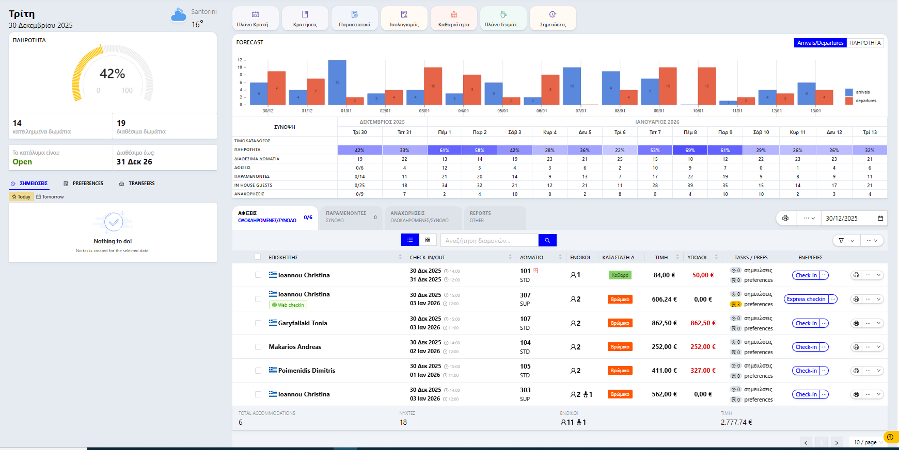

# Επισκόπηση (Dashboard) \*

Η Επισκόπηση είναι η κεντρική οθόνη του Hotelizer PMS, σχεδιασμένη για να παρέχει στον χρήστη μια άμεση και ολοκληρωμένη εικόνα της κατάστασης του καταλύματος σε πραγματικό χρόνο.

<figure><figcaption></figcaption></figure>

#### Γενικά Στοιχεία & Πληρότητα

Στο αριστερό μέρος της οθόνης εμφανίζονται τα βασικά στατιστικά της ημέρας:

* Ποσοστό Πληρότητας: Ένα κυκλικό γράφημα που δείχνει το τρέχον ποσοστό πληρότητας.
* Κατειλημμένα & Διαθέσιμα Δωμάτια: Αριθμητική απεικόνιση των δωματίων που είναι σε χρήση και αυτών που παραμένουν ελεύθερα.
* Κατάσταση Καταλύματος: Ένδειξη αν το κατάλυμα είναι Open ή κλειστό, καθώς και η ημερομηνία έως την οποία υπάρχει διαθεσιμότητα.

#### Γρήγορη Πρόσβαση (Top Menu)

Στο επάνω μέρος βρίσκονται εικονίδια για άμεση μετάβαση στις κυριότερες λειτουργίες:

* Πλάνο Κρατήσεων, Κρατήσεις, Παραστατικά, Ισολογισμός, Καθαριότητα, Πλάνο Γευμάτων και Σημειώσεις.

#### Πρόγνωση (Forecast) & Σύνοψη

Στο κεντρικό τμήμα εμφανίζεται το γράφημα Forecast, το οποίο μπορεί να εναλλάσσεται μεταξύ δύο προβολών:

* Arrivals/Departures: Μπάρες που δείχνουν τις αναμενόμενες αφίξεις (μπλε) και αναχωρήσεις (πορτοκαλί) για τις επόμενες ημέρες.
* Πληρότητα (Occupancy): Μπάρες που απεικονίζουν το ποσοστό πληρότητας ανά ημέρα.
* Πίνακας Σύνοψης: Ακριβώς κάτω από το γράφημα, ένας αναλυτικός πίνακας προβάλλει δεδομένα όπως: Διαθέσιμα δωμάτια, Αφίξεις, Παραμένοντες, In-house guests και Αναχωρήσεις.

#### Λίστα Διαμονών

Στο κάτω μέρος της σελίδας παρατίθενται οι τρέχουσες κινήσεις (Αφίξεις, Παραμένοντες, Αναχωρήσεις).

**Στήλες Πίνακα:**

* Επισκέπτης: Το ονοματεπώνυμο και η εθνικότητα του πελάτη (συμπεριλαμβάνεται ένδειξη Web check-in αν έχει ολοκληρωθεί).
* Check-in/Out: Ημερομηνίες και ώρες άφιξης/αναχώρησης.
* Δωμάτιο: Ο αριθμός και ο τύπος του δωματίου.
* Ενοίκου: Ο αριθμός των ατόμων που διαμένουν.
* Κατάσταση Δωματίου: Χρωματική ένδειξη για το αν το δωμάτιο είναι Καθαρό (πράσινο) ή Βρώμικο (πορτοκαλί).
* Τιμή: Η συνολική αξία της διαμονής.
* Υπόλοιπο: Εμφάνιση τυχόν οφειλόμενου ποσού με κόκκινο χρώμα για άμεση προσοχή.
* Tasks / Prefs: Εικονίδια που υποδεικνύουν αν υπάρχουν σημειώσεις ή προτιμήσεις πελάτη.

**Άμεσες Ενέργειες & Πλήρες Μενού Επιλογών:**

Για κάθε κράτηση, έχετε στη διάθεσή σας τις παρακάτω ενέργειες:

Κουμπή διαδικασίας μεταβολής κατάσταστης (status):&#x20;

* Check-in: Προεπιλογή.&#x20;
* Express check-in
* Ακύρωση
* No show
* Ανάκληση Επιβεβαίωσης
* Express checkin
* Set as Tentative
* Set as Optional

Εκτύπωση κράτησης (εκτύπωση registration card).&#x20;

Μενού "Περισσότερα" (τρεις τελείες ...): Πατώντας το εικονίδιο με τις τρεις τελείες, ανοίγει το πλήρες μενού ενεργειών:

* View Reservation / View Online Reservation: Προβολή των στοιχείων της κράτησης ή της online καταχώρησης.
* Print Reg. Card: Εκτύπωση της κάρτας εγγραφής του πελάτη.
* Διαχείριση Διαμονής / Αλλαγή Διαμονής: Παραμετροποίηση των λεπτομερειών της κράτησης ή μετακίνηση σε άλλο δωμάτιο/ημερομηνία.
* Στάθμευση Διαμονής: Διαχείριση θέσης parking.
* Κλείδωμα Κράτησης: Ασφάλιση της κράτησης έναντι ακούσιων αλλαγών.
* Εκχώρηση Πρωτεύοντος Επισκέπτη: Ορισμός του κύριου υπεύθυνου για τη διαμονή.
* Αλλαγή Τιμοκαταλόγου: Τροποποίηση της τιμολογιακής πολιτικής.
* Παράταση / Μείωση Διαμονής: Γρήγορη προσαρμογή των ημερών παραμονής.
* Τροποποίηση Αναχώρησης/Άφιξης: Αλλαγή των ωρών ή ημερομηνιών check-in/out.
* Αλλαγή Ενοίκων: Διαχείριση των ατόμων που διαμένουν στο δωμάτιο.
* Financial actions: Πρόσβαση σε οικονομικές κινήσεις, πληρωμές και παραστατικά.
* Delete: Οριστική διαγραφή της εγγραφής.

#### Σημειώσεις & Tasks

Στην αριστερή πλευρά, κάτω από τα στατιστικά, υπάρχει το τμήμα Tasks/Σημειώσεις. Εκεί εμφανίζονται εκκρεμότητες για την τρέχουσα ή την επόμενη ημέρα (π.χ. Preferences πελατών ή ειδικά Transfers), βοηθώντας στην καλύτερη οργάνωση.
