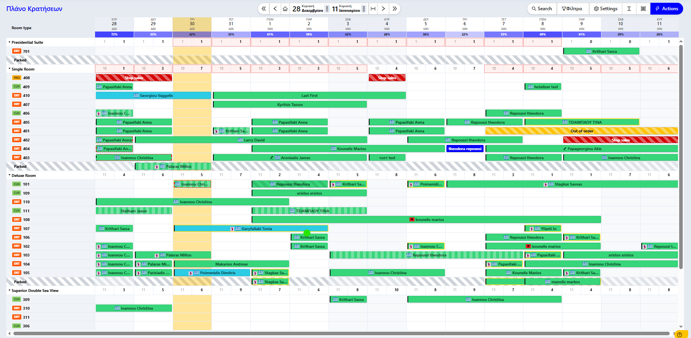

# Πλάνο Κρατήσεων

Το Πλάνο Κρατήσεων (Calendar) αποτελεί την "καρδιά" του Hotelizer PMS, προσφέροντας μια δυναμική και πλήρως διαδραστική απεικόνιση όλων των κρατήσεων και της διαθεσιμότητας των δωματίων.

<figure><figcaption></figcaption></figure>

#### Κεντρικό Μενού & Φίλτρα

<figure><figcaption></figcaption></figure>

Στο επάνω μέρος της οθόνης βρίσκονται τα εργαλεία ελέγχου του πλάνου:

* Πλοήγηση Ημερομηνιών: Χρησιμοποιήστε τα βέλη ή το ημερολόγιο για να μεταβείτε σε συγκεκριμένη περίοδο.
* Search: Αναζήτηση συγκεκριμένης κράτησης απευθείας στο πλάνο.
* Φίλτρα: Δυνατότητα φιλτραρίσματος ανά τύπο δωματίου, κατάσταση ή άλλα κριτήρια.
* Settings: Παραμετροποίηση της εμφάνισης του πλάνου (π.χ. ύψος γραμμών, εμφάνιση ονομάτων).
* Actions: Μπλε κουμπί για γρήγορες μαζικές ενέργειες ή νέες καταχωρήσεις.

#### Δομή Πλάνου & Στατιστικά

Το πλάνο είναι οργανωμένο έτσι ώστε να παρέχει πληροφορίες από το γενικό (κατάλυμα) στο ειδικό (συγκεκριμένο δωμάτιο):

* Συνολική Πληρότητα Καταλύματος: Στην κορυφή του ημερολογίου, κάτω από κάθε ημερομηνία, εμφανίζεται με μπλε φόντο το συνολικό ποσοστό πληρότητας του ξενοδοχείου για τη συγκεκριμένη ημέρα.
* Στατιστικά ανά Τύπο Δωματίου (Room Type): Πριν την ανάπτυξη των δωματίων κάθε κατηγορίας, υπάρχει μια γραμμή σύνοψης που δείχνει τον συνολικό αριθμό των δωματίων και το ποσοστό πληρότητας ή τα διαθέσιμα δωμάτια για τον συγκεκριμένο τύπο.
* Κατάσταση & Καθαριότητα Δωματίου: Στην αριστερή στήλη, δίπλα στον αριθμό κάθε δωματίου, υπάρχουν οι εξής ενδείξεις:
  * CLN (Clean): Πράσινη ένδειξη για καθαρό δωμάτιο.
  * DRT (Dirty): Κόκκινη ένδειξη για βρώμικο δωμάτιο.
  * PRO (In Progress): Ένδειξη για δωμάτιο που βρίσκεται σε διαδικασία καθαρισμού.
  * OOS (Out of Service): Δωμάτιο εκτός υπηρεσίας
  * OOO (Out of Order):  Δωμάτιο εκτός λειτουργίας
  * INP (Inspected): Το δωμάτιο έχει ελεγχθεί&#x20;

#### Διαχείριση Κρατήσεων&#x20;

Οι κρατήσεις και οι περιορισμοί εμφανίζονται ως οπτικά στοιχεία πάνω στις γραμμές των δωματίων:

* Κρατήσεις: Εμφανίζονται ως χρωματιστές μπάρες με το όνομα του επισκέπτη και τη σημαία της χώρας του.
* Stop Sales & Out of Order: Ειδικές σημάνσεις με διαγράμμιση υποδεικνύουν περιόδους που ένα δωμάτιο είναι εκτός λειτουργίας (κίτρινη διαγράμμιση) ή οι πωλήσεις έχουν σταματήσει (κόκκινη διαγράμμιση).
* Parked: Στο τέλος κάθε τύπου δωματίου υπάρχει η γραμμή "Parked" για κρατήσεις που δεν έχουν ακόμη αντιστοιχιστεί σε συγκεκριμένο δωμάτιο.

> Drag & Drop: Μπορείτε να μετακινήσετε μια κράτηση σε άλλο δωμάτιο ή ημερομηνία σέρνοντάς την με το ποντίκι.

#### Δεξί Κλικ Μενού

Οι επιλογές που έχετε και μπορείτε να τις εκτελέσετε άμεσα από το πλάνο κάνοντας δεξί κλικ σε κάποια κράτηση είναι:

* **View Reservation**: Εμφάνιση καρτέλας της κράτησης
* **Print Reg. Card**: Εκτύπωση της registration card
* **Διαχώριση Διαμονής (Split)**: Διαχώριση της διαμονής με επιλογή ημερομηνίας και δωματίου
* **Αλλαγή Διαμονής**: Μετακινήστε την κράτηση σε κάποιο άλλο δωμάτιο αλλά και ημερομηνία.
* **Στάθμευση Διαμονής**: Μετακίνηση της κράτησης στο Parked που στην ουσία την χαρακτηρίζει ως κράτηση χωρίς ανάθεση δωματίου
* **Κλείδωμα Κράτησης**: Μπορείτε να κλειδώσετε την κράτηση στο δωμάτιο αυτό ώστε να μην μπορεί να μετακινηθεί.
* **Εκχώρηση Πρωτεύοντος επισκέπτη**: Δείτε και επεξεργαστείτε τα στοιχεία των επισκεπτών
* **Αλλαγή τιμοκαταλόγου**: Αλλάξτε τιμοκατάλογο και τιμές
* **Παράταση διαμονής**: Από εδώ μπορείτε να παρατείνετε τη διαμονή της κράτησης.
* **Μείωση διαμονής**: Μειώστε τις ημέρες της κράτησης
* **Τροποποίηση αναχώρησης/άφιξης:** Εδώ μπορείτε να τροποποιήσετε την ώρα άφιξης και αναχώρησης.
* **Αλλαγή Ενοίκων:** Εδώ μπορείτε να αλλάξετε τον αριθμό των ενοίκων, να προσθέσετε ή να αφαιρέσετε άτομα.
* **Financial actions:** Επιλογές Διαμονής, Τιμολόγηση, Προσθήκη Έξτρα, Μεταφορά Προχρεώσεων, Door Lock.

#### Γρήγορη Προβολή (Reservation Popup)

<figure><figcaption></figcaption></figure>

Κάνοντας κλικ σε μια κράτηση, εμφανίζεται ένα αναδυόμενο παράθυρο (Popup) για επισκόπιση κράτησης με όλες τις βασικές πληροφορίες:

* Room Details: Εμφανίζει το όνομα επισκέπτη, τον κωδικό κράτησης, την πηγή (π.χ. Telephone), τις ημερομηνίες Check-in/Out, τη διάρκεια, τον αριθμό ενοίκων και το ADR (μέση ημερήσια τιμή).
* Tabs (Tasks / Preferences): Γρήγορη πρόσβαση σε εκκρεμότητες ή ειδικές προτιμήσεις του πελάτη.
* Κατάσταση Κράτησης: Ένδειξη στο επάνω μέρος (π.χ. Επιβεβαιωμένη με πράσινο χρώμα).
* Οικονομική Εικόνα: Στο κάτω μέρος φαίνεται το συνολικό ποσό και το υπόλοιπο της κράτησης.
* Κουμπί "Προβολή Κράτησης": Μπλε κουμπί για μετάβαση στην πλήρη καρτέλα της κράτησης για αναλυτική επεξεργασία.
* Quick Menu (...): Επιπλέον γρήγορες ενέργειες απευθείας από το popup.
