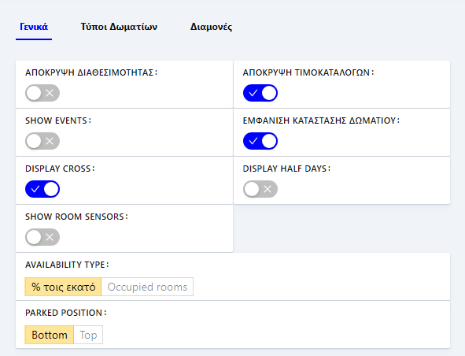

# Ρυθμίσεις

Το πλάνο κρατήσεων είναι customized ανά χρήστη, δηλαδή ο κάθε χρήστης μπορεί να βλέπει το πλάνο σύμφωνα με τις προτιμήσεις του, θέτοντας ρυθμίσεις από το εικονίδιο του γραναζιού στα δεξιά της σελίδας. Αυτές οι ρυθμίσεις αποθηκεύονται για κάθε χρήστη ξεχωριστά, χωρίς να επηρεάζουν την προβολή άλλων χρηστών. Οι ρυθμίσεις χωρίζονται σε τρεις ενότητες:

* Γενικές Ρυθμίσεις
* Ρυθμίσεις για τους Τύπους Δωματίων
* Ρυθμίσεις για τις Διαμονές

<figure><figcaption></figcaption></figure>

Οι γενικές ρυθμίσεις αναφέρονται στα εξής: (αυτά μπορεί να μην αναφερθούν όλα, αλλά ένα δύο παραδείγματα)

1. Στην απόκρυψη διαθεσιμότητας, δηλαδή εμφάνιση ή απόκρυψη της μπάρας, που εμφανίζεται κάτω από ημερομηνίες του πλάνου μας.
2. Στην απόκρυψη τιμοκαταλόγων, δηλαδή εμφάνιση ή απόκρυψη της μπάρας, που εμφανίζεται κάτω από τις ημερομηνίες στο πλάνο με τα price schemes.
3. Στα Show Events, δηλαδή εμφάνιση μιας γραμμής με events τα οποία έχουμε την δυνατότητα να τα περάσουμε από τις ρυθμίσεις.
4. Στο Display Cross, δηλαδή εμφάνιση ενός σταυρού κατά την μετακίνηση του ποντικιού στο πλάνο μας.
5. Στην εμφάνιση κατάστασης δωματίου, δηλαδή εμφάνιση της κατάστασης καθαριότητας δίπλα από κάθε δωμάτιο μας.
6. Στο Display Half Days, δηλαδή η κάθε κράτηση να ξεκινάει από το μισό του κελιού και όχι απ΄την αρχή.

<figure><figcaption></figcaption></figure>

Η καρτέλα με τις ρυθμίσεις για τους τύπους δωματίων αφορά: (αυτά μπορεί να μην αναφερθούν όλα, αλλά ένα δύο παραδείγματα)

1. Την απόκρυψη τύπων, δηλαδή εμφάνιση ή απόκρυψη των τύπων δωματίων. Με την επιλογή αυτή μπορούμε να αλλάξουμε αρκετά την εμφάνιση του πλάνου. Σε περίπτωση που έχουμε επιλέξει να εμφανίζονται στο πλάνο μας μόνο τα δωμάτια, έχουμε τα δωμάτια μας το ένα κάτω από το άλλο και διαθέτουμε μια μπάρα parked στο τέλος. Επίσης, μπορούμε να αλλάξουμε τη σειρά των δωματίων, όπως θέλουμε, κάνοντας drag & drop στις τρεις τελείες δίπλα σε κάθε δωμάτιο και μετακινώντας τα στον κάθετο άξονα. Η άλλη επιλογή είναι τα δωμάτια να εμφανιστούν ανά τύπο δωματίου και επιπλέον έχουμε μια γραμμή Parked για τον κάθε τύπο καθώς και έξτρα πληροφορίες για την διαθεσιμότητα πάνω στην γραμμή του τύπου. Η μπάρα "Parked" είναι ένα χρήσιμο εργαλείο για την επανακατανομή (reallocation) κρατήσεων.
2. Οι κρατήσεις που τοποθετούνται στα parked υπολογίζονται στην διαθεσιμότητα. Αυτό συμβαίνει καθώς η διαθεσιμότητα υπολογίζεται με βάση τον τύπο δωματίου που είναι καταχωρημένη η εκάστοτε κράτηση.
3. Την απόκρυψη διαθεσιμότητας των τύπων δωματίων.
4. Τις πληροφορίες διαθεσιμότητας, είτε με ποσοστό είτε με αριθμό.
5. Το χρώμα διαθεσιμότητας, δηλαδή αναλόγως την διαθεσιμότητα, εμφανίζεται διαφορετικό χρώμα και
6. Τα Room type short name, δηλαδή θα μας εμφανίζεται η συντομογραφία του ονόματος του τύπου, αντί για το ολόκληρο όνομα.

<figure><figcaption></figcaption></figure>

Η καρτέλα με τις ρυθμίσεις για τις διαμονές αφορά: (αυτά μπορεί να μην αναφερθούν όλα, αλλά ένα δύο παραδείγματα)

1. Το στυλ
2. Την εμφάνιση συνόρου (σε κάθε κράτηση)
3. Την εμφάνιση χώρας
4. Την εμφάνιση πηγή
5. Το εικονίδιο πηγής
6. Τα Show Tasks
7. Τον τίτλο διαμονής
8. Τον χρωματισμό των δωματίων
9. Τα Lock move axis
10. Τα Event padding
11. Τα Display room upgrade
12. Τα Popover trigger
13. Τα Compact popover
14. Τα Popover location
